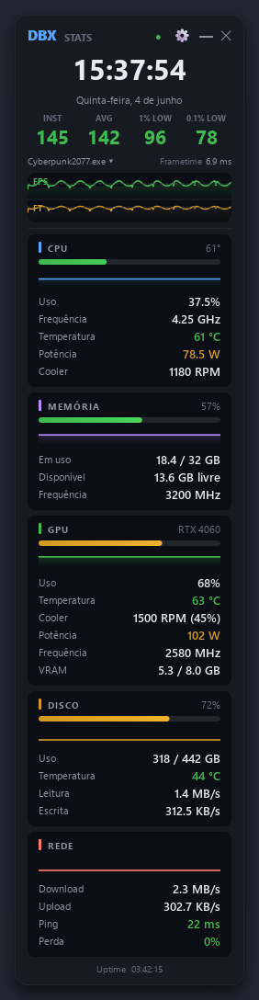
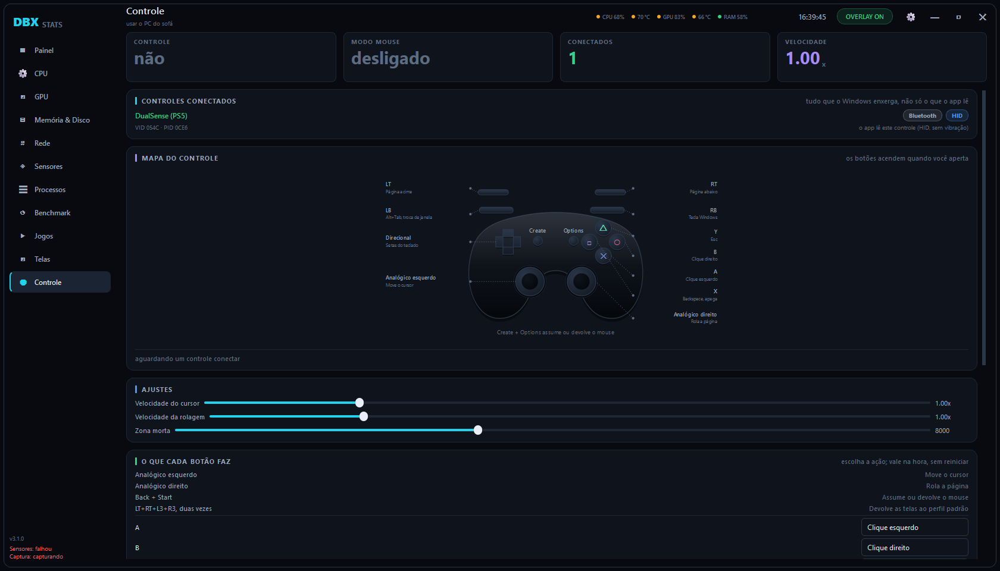
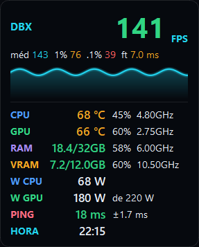
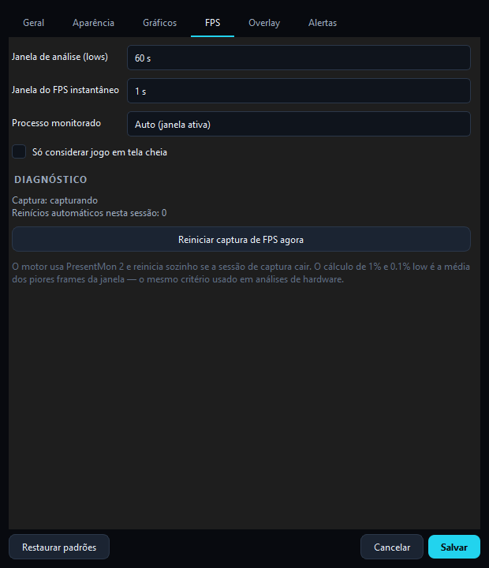

# Vantage

Monitor de hardware e desempenho em jogos para Windows e Linux. O painel reúne CPU, GPU, memória, disco, rede, sensores e processos. No Windows, também mede FPS e frametimes por jogo.

[](https://github.com/vinibotelho1998/Vantage/actions/workflows/release.yml)


<p align="center">
  
</p>

<p align="center">
  
</p>

## Linux

Nesta cópia, rode `./Vantage.sh` para abrir. O lançador usa o ambiente local
`.venv` quando presente. Em outra máquina com Python 3.12 ou superior:

```sh
python3 -m venv .venv
.venv/bin/pip install -e .
./Vantage.sh
```

O painel Qt reúne CPU, GPU, memória, armazenamento, rede e processos. A aba Sensores
lê o hwmon e permite exportar CSV. A GPU usa DRM/sysfs quando o driver expõe a
telemetria (por exemplo, AMDGPU) ou NVML no driver NVIDIA. As telas vêm do compositor
e as configurações de monitor são abertas no painel do sistema. A aba Controle lista
joysticks publicados pelo kernel. Na aba Jogos, use **Procurar jogos** para encontrar
as bibliotecas Steam ou escolha um executável Linux. Big Picture usa o cliente Steam.
O painel flutuante de sensores pode ser ativado manualmente. O compositor define seu posicionamento.
As configurações e relatórios ficam em `$XDG_DATA_HOME/Vantage` (por padrão
`~/.local/share/Vantage`). Os atalhos de teclado atuam com o aplicativo em foco.

Nesta versão Linux, a captura de FPS e de frametimes por jogo, os benchmarks
de quadros e disco, a limpeza de memória, os perfis automáticos de monitor e o
modo mouse pelo controle continuam exclusivos do backend Windows. Os recursos
PresentMon, ETW, XInput e LibreHardwareMonitor descritos abaixo são da versão Windows.
A detecção de tela cheia e o overlay automático por jogo também dependem do Windows.

Para testar a interface com configurações temporárias e sensores reais:

```sh
QT_QPA_PLATFORM=offscreen PYTHONPATH=src .venv/bin/python scripts/smoke_linux.py
```

### CI e distribuição Linux

O GitHub Actions testa o núcleo e abre as telas no Ubuntu 24.04 em pull requests e
pushes para main. Cada build Linux gera um pacote de fontes e lançador
`Vantage-linux.tar.gz` e seu SHA-256. Uma tag `vX.Y.Z` que corresponda à versão
do projeto publica esses arquivos em Releases. Para usar o pacote extraído,
instale as dependências com os comandos desta seção e execute `./Vantage.sh`.

## O que ele faz no Windows

**Captura de FPS que não desiste.** O motor roda em três camadas independentes:
supervisor, leitor e agregador. O leitor só faz parsing do CSV do PresentMon; toda
a estatística acontece fora do caminho crítico, 4× por segundo. Se a sessão ETW
cair, o jogo fechar o swapchain ou o driver reiniciar, o supervisor detecta e sobe
tudo de novo sozinho, com backoff. Um watchdog ainda vigia o jogo em foco: se ele
está em tela cheia e não sai nenhum frame em 20 s, a captura reinicia sem você
precisar fazer nada.

**Métricas que um entusiasta realmente usa:**

| Métrica | Como é calculada |
| --- | --- |
| FPS atual | média dos frametimes da última janela (0,5 / 1 / 2 s), não `1000/último frame`: por isso o número para de tremer |
| FPS médio | `1000 / média dos frametimes` da janela de análise |
| 1% e 0.1% low | média dos piores 1% / 0.1% frames, o mesmo critério usado em análises de hardware |
| P1 / P0.1 | percentis 99 e 99.9 do frametime, para comparar com ferramentas que usam percentil |
| Stutter | % de frames acima de 1,5× a mediana |
| Engasgos | frames acima de 50 ms ou 3× a mediana |
| Consistência | coeficiente de variação do frametime, normalizado em 0–100 |
| Fluidez | nota composta: consistência + distância do 1% low + penalidade por engasgo |
| Gargalo | compara `CPUBusy` e `GPUBusy` por frame: CPU, GPU, limitado por VSync/cap ou balanceado |
| Latência | render latency e clique → tela (click-to-photon), direto do PresentMon 2 |
| Quadros descartados | frames que nunca chegaram ao display |

**Gráficos que mostram o que aconteceu.** As linhas usam interpolação cúbica
monotona (Fritsch–Carlson): curva lisa que nunca inventa um pico que não existe
nos dados. Quando há mais amostras que pixels, cada coluna desenha a faixa entre
o mínimo e o máximo daquele intervalo: um spike de um frame continua visível com
5 minutos de histórico na tela. A escala vertical se ajusta com transição
amortecida, então o gráfico não pula a cada novo máximo. Passe o mouse para ler
os valores exatos de qualquer ponto.

**Telas:**

- **Painel:** visão geral com KPIs, linha do tempo multi-série, jogo em foco com
  frametime ao vivo e cards de CPU/GPU/RAM/disco/rede.
- **Jogos:** frametime em destaque, FPS ao longo do tempo, histograma de FPS,
  curva de percentis, entrega de quadros, latência, gargalo e estatísticas da sessão.
- **CPU:** uso e temperatura, frequência, potência, grade de núcleos com clock por
  thread, dados do processador e top processos.
- **GPU:** carga, VRAM, clocks, potência, PCIe, encoder/decoder e os motivos de
  throttle relatados pelo driver.
- **Memória & Disco:** RAM, cache, swap, atividade de I/O e um card por unidade
  com temperatura e vida útil.
- **Rede:** throughput, latência, jitter, perda e volume acumulado.
- **Sensores:** a árvore inteira do LibreHardwareMonitor com atual/mín/méd/máx e
  exportação para CSV.
- **Processos:** quem está comendo CPU e memória, com o jogo destacado.
- **Benchmark:** corrida cronometrada, resultado completo, comparação com corridas
  anteriores e exportação dos frametimes.

**Ainda:** overlay in-game click-through configurável, alertas de temperatura e
uso na bandeja, atalhos globais, tema com cor de destaque, escala de interface e
janela sem moldura com redimensionamento e snap nativos do Windows.

<p align="center">
  
  &nbsp;&nbsp;&nbsp;
  
</p>

## Atalhos

| Atalho | Ação |
| --- | --- |
| `Ctrl+Alt+R` | zera as estatísticas da sessão |
| `Ctrl+Alt+O` | liga/desliga o overlay |
| `Ctrl+Alt+B` | inicia/para o benchmark |

## Instalação

Baixe o **Vantage-Setup.exe** da [última release](https://github.com/vinibotelho1998/Vantage/releases/latest),
execute e pronto. O instalador leva o app, o LibreHardwareMonitor, o PresentMon e
instala sozinho o que faltar de runtime. Não precisa de Python nem do repositório.

O instalador se chama **Vantage**, com assistente em português, licença,
atalho opcional na área de trabalho e desinstalador que pergunta se você quer
manter suas configurações.

Para gerar o instalador você mesmo, a partir de um clone limpo:

```powershell
.\BUILD.bat
```

Ele acha o Python, monta um ambiente próprio, baixa o que falta (inclusive uma
cópia local do Inno Setup, sem instalar nada no sistema) e entrega
`dist\Vantage-Setup.exe`, o arquivo único para mandar para outra pessoa.

## Requisitos

- Windows 10/11 x64
- [.NET Desktop Runtime](https://dotnet.microsoft.com/download) 6 e 8 (LibreHardwareMonitor)
- Visual C++ Redistributable x64
- Executar como administrador (sensores de CPU/placa e captura de FPS)

O instalador cuida das dependências de runtime automaticamente.

## Desenvolvimento

```powershell
py -3.12 -m venv .venv
.\.venv\Scripts\python.exe -m pip install -e ".[dev]"

.\.venv\Scripts\pythonw.exe -m vantage            # executa o app
.\.venv\Scripts\python.exe -m pytest               # testes
.\.venv\Scripts\python.exe -m ruff check src tests # lint
.\.venv\Scripts\python.exe scripts\check_env.py    # valida a stack
.\.venv\Scripts\python.exe scripts\smoke_ui.py     # monta e pinta todas as telas
.\.venv\Scripts\python.exe scripts\smoke_fps.py    # motor de FPS contra o PresentMon real
.\.venv\Scripts\python.exe scripts\preview.py      # regenera as imagens do README
```

771 testes cobrem a engine de FPS, séries e métricas, telas, gerenciador de
monitores, controle e sessões, a maioria sem depender de display nem hardware
real.

## Arquitetura

A engine é independente da interface e testável sem display. As views são burras:
recebem um snapshot pronto e desenham; só a tela visível é atualizada, então
manter o app aberto custa quase nada.

```
src/vantage/
├── __main__.py          entrada (eleva admin, sobe engine + UI)
├── app.py               controlador: timers, seleção do jogo, alertas, benchmark
├── config.py            Settings tipado e validado, em %APPDATA%/Vantage
├── theme.py             design tokens: paleta, tipografia, escalas de cor
├── core/
│   ├── frames.py        métricas de frame (lows, percentis, stutter, gargalo)
│   ├── series.py        séries temporais, acumulador mín/méd/máx, EMA
│   ├── units.py         formatação de grandezas
│   └── export.py        relatórios CSV
├── sensors/
│   ├── fps.py           PresentMon 2: supervisor + leitor + agregador
│   ├── lhm.py           LibreHardwareMonitor (curado + árvore completa)
│   ├── gpu.py           NVML: clocks, VRAM, PCIe, throttle, potência
│   ├── collector.py     snapshot unificado por ciclo
│   ├── procs.py         monitor de processos
│   └── net.py           latência, jitter e perda
├── platform/            win32: admin, fullscreen, click-through, hotkeys
└── ui/
    ├── main_window.py   chrome próprio, barra lateral, pilha de telas
    ├── charts.py        linhas suaves, envelope mín/máx, gauges, histograma
    ├── components.py    cards, tiles, linhas de métrica, badges
    ├── views/           dashboard · gaming · cpu · gpu · memory · network ·
    │                    sensors · processes · benchmark
    ├── overlay.py       overlay in-game
    ├── settings.py      configurações por abas
    └── tray.py          bandeja do sistema
```

## Build

```powershell
.\BUILD.bat                                     # instalador completo
powershell -File packaging\build.ps1 -SemInstalador # so' a pasta dist\Vantage
```

A arte do assistente é gerada por `scripts/make_installer_art.py` a partir do
tema do app e fica versionada em `packaging/assets`. A versão do instalador sai
de `src/vantage/__init__.py`, então não há número
para atualizar em dois lugares. Todo push na `main` também gera o instalador
pelo GitHub Actions e publica na release `latest`.

## Tecnologias

[PySide6](https://doc.qt.io/qtforpython/) · [LibreHardwareMonitor](https://github.com/LibreHardwareMonitor/LibreHardwareMonitor) · [PresentMon](https://github.com/GameTechDev/PresentMon) · [psutil](https://github.com/giampaolo/psutil) · [nvidia-ml-py](https://github.com/NVIDIA/nvidia-ml-py) · [pythonnet](https://github.com/pythonnet/pythonnet)

## Licença

[MIT](LICENSE).

O código deste projeto é MIT. `vendor/lhm` (LibreHardwareMonitor, MPL 2.0) e
`tools` (PresentMon, MIT) trazem binários de terceiros redistribuídos sem
modificação, cada um com sua licença original na própria pasta.

O instalador pede aceite dos [TERMOS_DE_USO.txt](TERMOS_DE_USO.txt), que
cobrem o privilégio de administrador exigido e a instalação do driver
PawnIO, além da licença MIT.

O apanhado de tudo que vem de terceiros está no [NOTICE.md](NOTICE.md).
